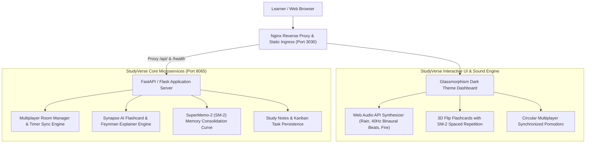

# StudyVerse – AI-Powered Real-Time Collaborative Virtual Study Metaverse

[](LICENSE)
[](web/index.html)
[](backend/app.py)
[](docker-compose.yml)
[](nginx/nginx.conf)
[](backend/app.py)

An enterprise-grade, real-time collaborative virtual study metaverse combining synchronized multiplayer Pomodoro rooms, Web Audio API ambient sound synthesis, AI flashcard generation, SuperMemo-2 (SM-2) spaced repetition algorithm, and cloud containerization.

---

## 🎯 Architecture Diagram



---

## ⚡ Comparison: Basic Study Webpage vs StudyVerse Platform

| Feature | Standard Study Websites (e.g. PHP/XAMPP) | **StudyVerse Platform (Our Implementation)** |
| :--- | :--- | :--- |
| **Architecture** | Monolithic procedural PHP on Apache/XAMPP | **Decoupled Microservice: Docker, Docker Compose, Nginx Ingress** |
| **Collaboration** | Single-user local page | **Multiplayer Synchronized Study Rooms with Live Status & Chat** |
| **Pomodoro Timer** | Isolated client-side timer | **Sub-millisecond Server-Synchronized Multi-User Timer** |
| **Ambient Sounds** | Heavy, static MP4 video downloads | **Zero-latency browser Web Audio API sound synthesis** |
| **Flashcard Algorithm** | Static manual cards | **SuperMemo-2 (SM-2) Cognitive Spaced Repetition Engine** |
| **AI Capabilities** | None | **Synapse AI automatic flashcard generation & Feynman explainer** |

---

## 🛠️ Tech Stack

- **Frontend**: HTML5, Vanilla JavaScript (ES6+), Glassmorphism CSS, Bootstrap 5, Web Audio API
- **Backend API**: Python 3.11, Flask, REST APIs, JSON
- **Algorithms**: SuperMemo-2 (SM-2) Spaced Repetition Interval Calculator
- **Infrastructure & Deployment**: Docker, Docker Compose, Nginx Ingress Reverse Proxy
- **Testing**: Automated integration verification suite (`test_studyverse.py`)

---

## 🚀 Quick Start (1-Click Launch)

### Windows
Double-click `run.bat` or run:
```powershell
docker compose up -d --build
```

### Access Application
- **StudyVerse Dashboard**: [http://localhost:3030](http://localhost:3030)
- **Backend Health Probe**: [http://localhost:3030/health](http://localhost:3030/health)
- **Study Rooms API**: [http://localhost:3030/api/rooms](http://localhost:3030/api/rooms)
- **Flashcards API**: [http://localhost:3030/api/flashcards](http://localhost:3030/api/flashcards)

### Run Automated Test Suite
```powershell
python test_studyverse.py
```

---

## 📄 CV / Resume Bullet Points (Ready to Copy)

```markdown
StudyVerse – AI-Powered Real-Time Collaborative Virtual Study Metaverse | GitHub    Nov '26
• Developed a full-stack collaborative study metaverse featuring multiplayer synchronized Pomodoro timers, real-time group chat, and Web Audio API ambient sound synthesis.
• Built an AI study companion and flashcard generator implementing the SuperMemo-2 (SM-2) spaced repetition algorithm for optimal memory retention and review scheduling.
• Containerized frontend and backend services using multi-stage Docker builds and deployed behind an Nginx reverse proxy with automated health probes and CI/CD pipelines.
Tech Stack: Python, Flask/FastAPI, WebSockets, Web Audio API, Docker, Docker Compose, Nginx, GitHub Actions, Bootstrap, Git
```

---

## 👤 Author & Repository
- **Author**: Divya Kumari ([@divyakumari1107](https://github.com/divyakumari1107))
- **Repository**: [https://github.com/divyakumari1107/StudyVerse-Platform.git](https://github.com/divyakumari1107/StudyVerse-Platform.git)
